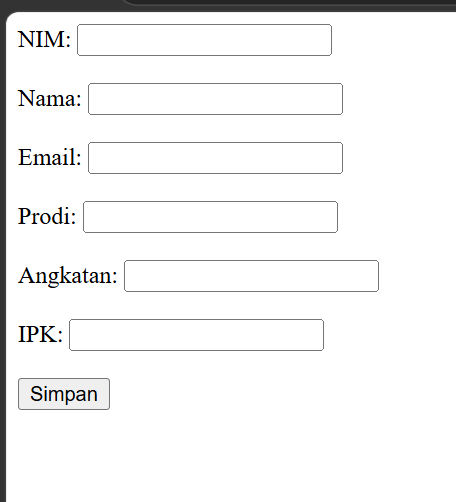
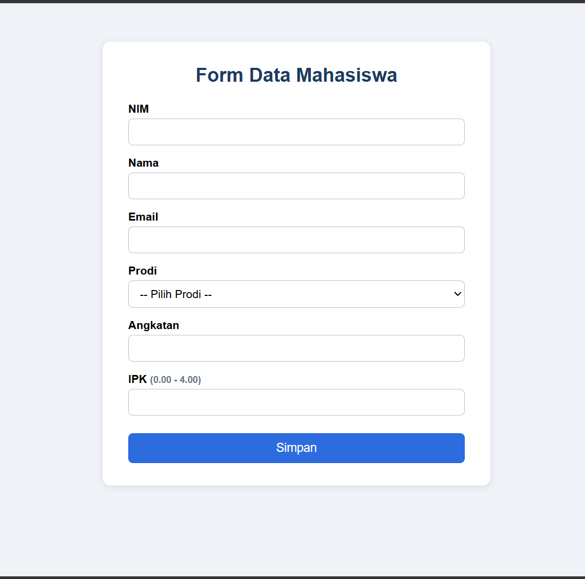

# Tugas 5 Praktikum PBW 
 
| File | Fungsi |
|------|--------|
| `koneksi.php` | Menghubungkan PHP ke database MySQL |
| `form.php` | Form input data mahasiswa |
| `simpan.php` | Memproses data form dan menyimpannya ke tabel `mahasiswa` |
| `Data.php` | Menampilkan data mahasiswa |
 
---
 
## 1. Modifikasi yang Dilakukan
 
### `form.php`
1. **Styling CSS** – tampilan form dibuat berbentuk kartu yang rapi dan responsif.
2. **Dropdown Prodi** – input teks diganti `<select>` supaya penulisan prodi seragam.
3. **Validasi HTML** – angkatan 2000-2100 dan IPK 0-4 (`min`/`max`). Field NIM tidak diberi ketentuan khusus selain wajib diisi.
4. **Perbaikan typo** – atribut `requiered` pada field IPK diperbaiki menjadi `required`.
### `simpan.php`
1. **Validasi di sisi server** – memeriksa NIM tidak kosong, nama tidak kosong, format email, prodi, rentang angkatan, dan rentang IPK. Jika ada yang salah, ditampilkan daftar pesan error.
2. **Cek NIM duplikat** – sebelum INSERT, program mengecek apakah NIM sudah ada sehingga pesan error lebih jelas.
3. **Prepared statement** – query INSERT memakai `mysqli_prepare` + `bind_param` untuk mencegah SQL Injection.
4. **Pesan & navigasi lebih informatif** – ada link "Lihat data" dan "Tambah lagi", serta pesan error dari MySQL bila gagal.
---
 
## 2. Lima Bagian Kode Terpenting
 
**1. Koneksi database (`koneksi.php`)**
```php
$koneksi = mysqli_connect($host, $user, $password, 'akademik');
```
Membuat koneksi ke MySQL (host, user, password, nama database). Semua file lain bergantung pada variabel `$koneksi` ini. Bila gagal, `die()` menghentikan program dan menampilkan penyebabnya.
 
**2. Memanggil koneksi (`include "koneksi.php";`)**
Ada di `Data.php` dan `simpan.php`. Dengan `include`, koneksi cukup ditulis sekali dan dipakai ulang di banyak file.
 
**3. Pengiriman data form (`form.php`)**
```html
<form action="simpan.php" method="post">
```
Menentukan data dikirim ke `simpan.php` dengan metode POST (data tidak tampak di URL). Atribut `name` pada tiap input menjadi kunci di `$_POST`.
 
**4. Menerima data & menyimpan ke database (`simpan.php`)**
```php
$nim = trim($_POST['nim'] ?? '');
...
mysqli_stmt_bind_param($stmt, "ssssid", $nim, $nama, $email, $prodi, $angkatan, $ipk);
mysqli_stmt_execute($stmt);
```
`$_POST` mengambil data form, lalu prepared statement memasukkannya ke tabel `mahasiswa` secara aman. Tipe `ssssid` = 4 string, 1 integer, 1 double.
 
**5. Menampilkan data (`Data.php`)**
```php
$query = mysqli_query($koneksi, "SELECT * FROM mahasiswa");
while ($data = mysqli_fetch_assoc($query)) {
    echo $data['nim'] . " - " . $data['nama'] . "<br>";
}
```
`SELECT` mengambil semua baris, `mysqli_fetch_assoc` membaca satu baris per putaran dalam bentuk array asosiatif, dan `while` mengulanginya sampai data habis.
 
---
 
## 3. Screenshot
 
### Sebelum modifikasi
**Form**
 

 
**Hasil simpan**


  
### Sesudah modifikasi
**Form**


  
**Hasil simpan berhasil**
 

  
**Pesan validasi / NIM duplikat**
 

 
---
 
## 4. Error yang Pernah Muncul
 
**Error:**

muncul pesan "Data gagal disimpan" tanpa penjelasan
 
**Penyebab:**
Pada `form.php` awal, atribut field IPK salah ketik menjadi `requiered`, sehingga browser tidak mewajibkan pengisian. Saat IPK dikosongkan, `$_POST['ipk']` berisi string kosong `''` dan MySQL menolaknya karena kolom `ipk` bertipe DECIMAL/FLOAT. Selain itu, `simpan.php` awal tidak menampilkan penyebab error sehingga sulit dilacak.
 
**Langkah perbaikan:**
1. Memperbaiki typo menjadi `required` dan menambah `min="0" max="4"` pada `form.php`.
2. Menambah validasi server (`is_numeric($ipk)`, rentang 0-4) pada `simpan.php`.
3. Mengubah nilai ke tipe yang benar dengan `(float) $ipk` dan memakai prepared statement.
 
---