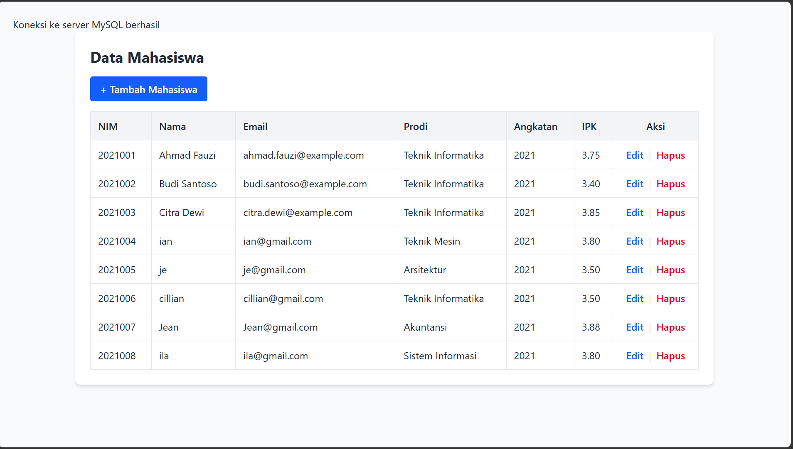
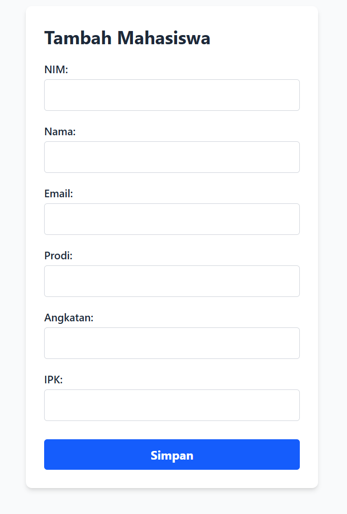
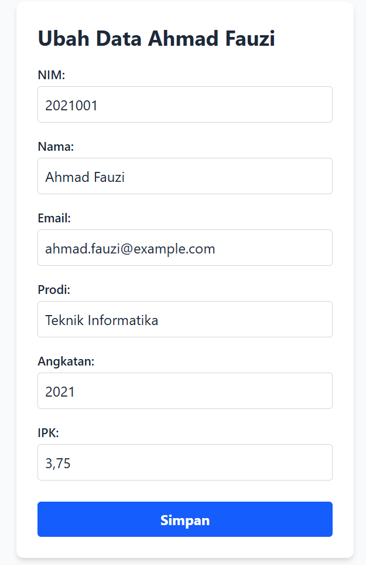
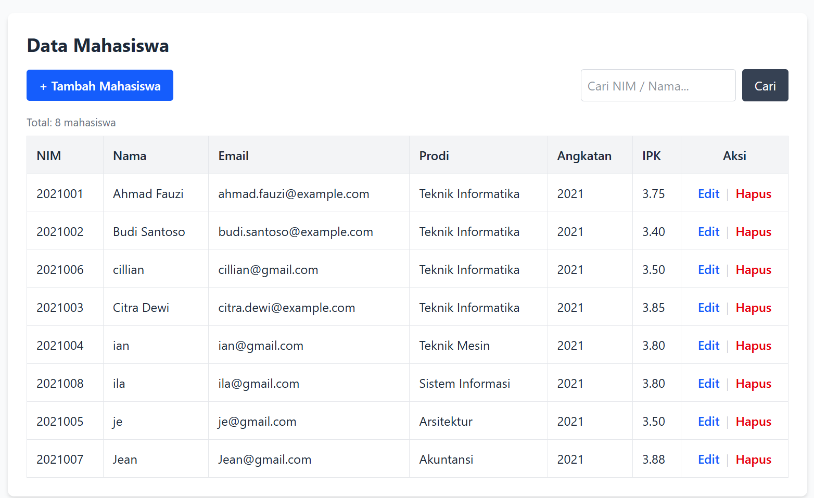
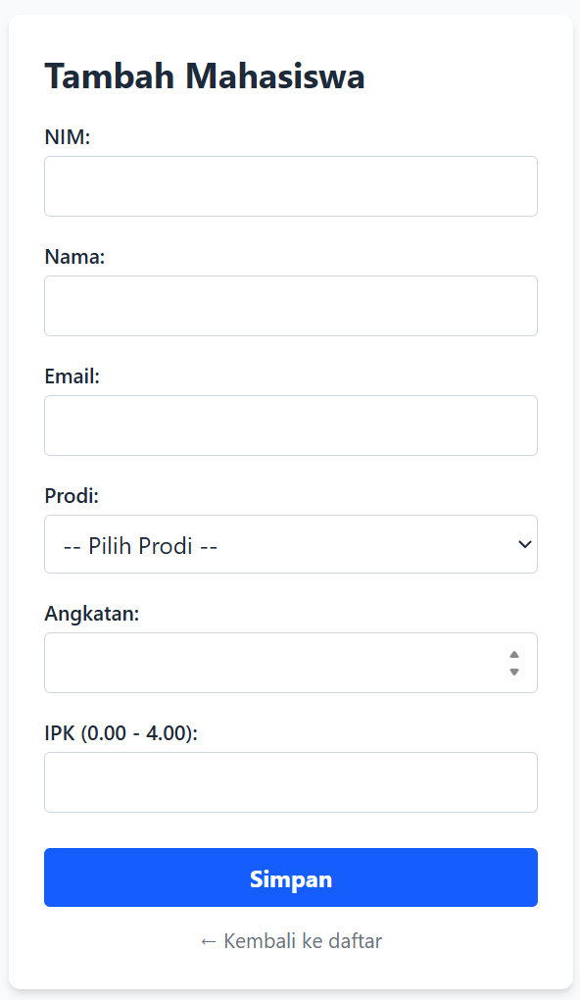
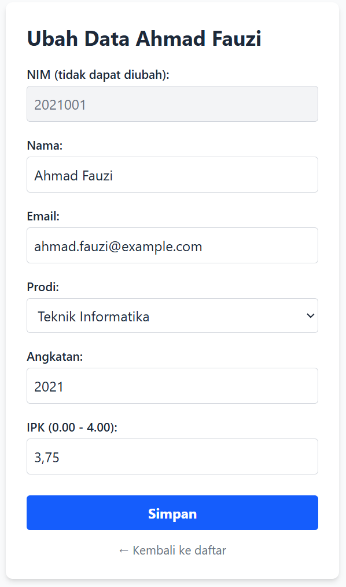
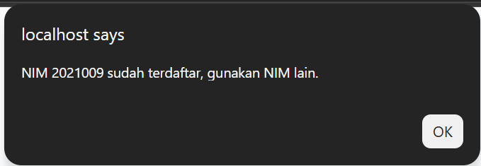

# Tugas 6 Praktikum PBW

| File | Fungsi |
|------|--------|
| `koneksi.php` | Koneksi ke MySQL + fungsi bantu (`h()`, `notif()`, `validasi_mahasiswa()`) |
| `index.php` | Menampilkan daftar mahasiswa (Read) + pencarian |
| `create.php` | Form tambah data |
| `store.php` | Memproses & menyimpan data baru (Create) |
| `edit.php` | Form ubah data (terisi otomatis) |
| `update.php` | Memproses perubahan data (Update) |
| `delete.php` | Menghapus data (Delete) |
| `data.php` | Tampilan sederhana NIM - Nama |

---

## 1. Modifikasi yang Dilakukan

1. **Fitur pencarian (`index.php`)** – data dapat dicari berdasarkan NIM atau Nama (`LIKE`), ditambah penghitung total, pengurutan nama, dan pesan "Data tidak ditemukan".
2. **Validasi server (`store.php`, `update.php`)** – fungsi `validasi_mahasiswa()` memeriksa nama, email, prodi, rentang angkatan (2000-2100) dan IPK (0-4). Field NIM tidak diberi ketentuan khusus selain tidak boleh kosong.
3. **Cek NIM duplikat (`store.php`)** – NIM yang sudah terdaftar ditolak dengan pesan yang jelas.
4. **Prepared statement di semua query** (`store`, `update`, `delete`, `edit`, `index`) – mencegah SQL Injection.
5. **Dropdown Prodi (`create.php`, `edit.php`)** – input teks diganti pilihan agar data seragam; pada edit, prodi lama otomatis terpilih.
6. **NIM readonly saat edit (`edit.php`)** – karena NIM dipakai sebagai kunci `WHERE` pada UPDATE.
7. **Keamanan & kerapian tampilan** – output di-escape dengan `h()` (anti XSS), pesan "Koneksi berhasil" dihapus dari `koneksi.php`, IPK diformat 2 desimal, dan `delete.php` memeriksa apakah data benar-benar terhapus.

---

## 2. Lima Bagian Kode Terpenting

**1. Koneksi database (`koneksi.php`)**
```php
$koneksi = mysqli_connect($host, $user, $password, 'akademik');
```
Membuat koneksi ke MySQL. Semua file lain memakai variabel `$koneksi` melalui `include "koneksi.php"`, sehingga pengaturan koneksi cukup ditulis satu kali.

**2. Menampilkan data & pencarian (`index.php`)**
```php
$stmt = mysqli_prepare($koneksi, "SELECT * FROM mahasiswa WHERE nim LIKE ? OR nama LIKE ? ORDER BY nama ASC");
...
while ($data = mysqli_fetch_assoc($query)) { ... }
```
`SELECT` mengambil data, lalu `while` + `mysqli_fetch_assoc` mengulang satu baris per putaran untuk dibuat menjadi baris tabel. Tombol Edit/Hapus membawa NIM lewat URL.

**3. Menyimpan data baru (`store.php`)**
```php
$stmt = mysqli_prepare($koneksi, "INSERT INTO mahasiswa (...) VALUES (?, ?, ?, ?, ?, ?)");
mysqli_stmt_bind_param($stmt, "ssssid", $nim, $nama, $email, $prodi, $angkatan, $ipk);
mysqli_stmt_execute($stmt);
```
Data dari `$_POST` divalidasi, lalu dimasukkan ke tabel dengan prepared statement. Tipe `ssssid` = 4 string, 1 integer, 1 double.

**4. Mengambil data untuk form edit (`edit.php`)**
```php
$stmt = mysqli_prepare($koneksi, "SELECT * FROM mahasiswa WHERE nim = ?");
...
<input name="nama" value="<?= h($data['nama']) ?>">
```
NIM dari URL (`$_GET['nim']`) dipakai untuk mengambil satu data, lalu nilainya diisikan ke form sehingga pengguna hanya mengubah bagian yang perlu.

**5. Mengubah data (`update.php`)**
```php
UPDATE mahasiswa SET nama = ?, email = ?, prodi = ?, angkatan = ?, ipk = ? WHERE nim = ?
```
Klausa `WHERE nim = ?` sangat penting; tanpa itu seluruh baris tabel ikut berubah. Cara kerja `delete.php` serupa: `DELETE FROM mahasiswa WHERE nim = ?` setelah konfirmasi `confirm()` di browser.

---

## 3. Screenshot

### Sebelum modifikasi
| Halaman | Gambar |
|---------|--------|
| Daftar data (index) |  |
| Form tambah |  |
| Form edit |  |

### Sesudah modifikasi
| Halaman | Gambar |
|---------|--------|
| Daftar data + pencarian |  |
| Form tambah (dropdown prodi) |  |
| Form edit (NIM readonly) |  |
| Pesan validasi / NIM duplikat |  |

---

## 4. Error yang Pernah Muncul

**Error:**
```
Fatal error: Uncaught mysqli_sql_exception: Duplicate entry '12345' for key 'mahasiswa.PRIMARY'
```

**Penyebab:**
Pada `store.php` awal, data langsung di-INSERT tanpa memeriksa apakah NIM sudah ada. Karena kolom `nim` adalah PRIMARY KEY, memasukkan NIM yang sama dua kali ditolak MySQL. Pada PHP 8.1 ke atas, kegagalan ini melempar exception sehingga halaman berhenti dengan Fatal error dan blok `else` ("Data gagal disimpan") tidak pernah dijalankan.

**Langkah perbaikan:**
1. Menambahkan pengecekan `SELECT nim FROM mahasiswa WHERE nim = ?` sebelum INSERT, dan menampilkan pesan "NIM sudah terdaftar".
2. Membungkus proses INSERT dengan `try { ... } catch (mysqli_sql_exception $e)` agar error apa pun tampil sebagai pesan yang rapi.
3. Menguji ulang dengan memasukkan NIM yang sama; sekarang muncul alert tanpa halaman error.

---