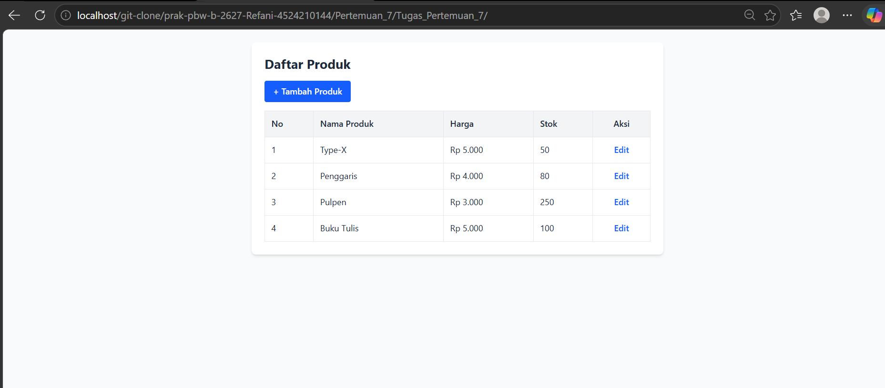
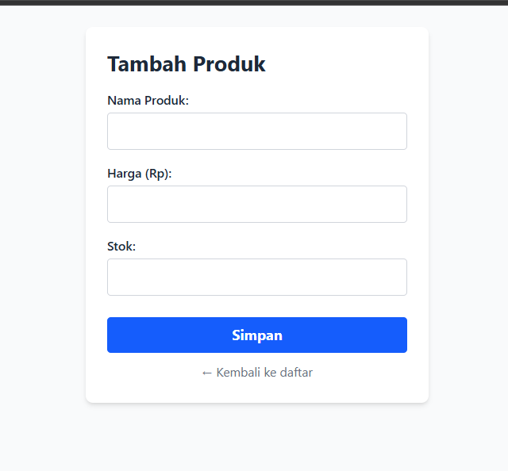
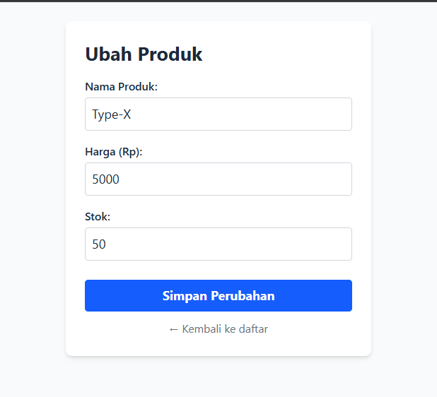
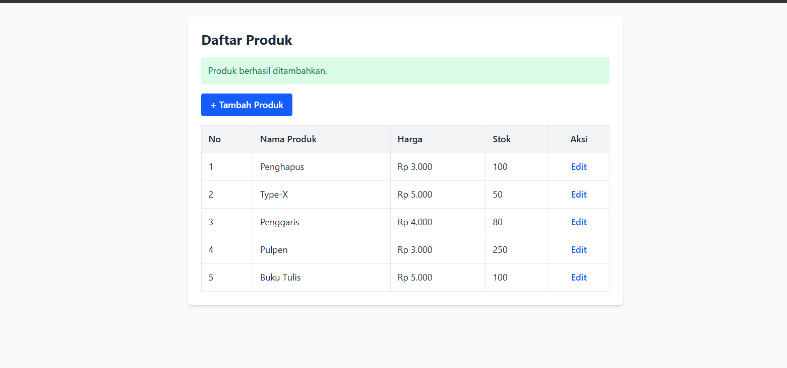
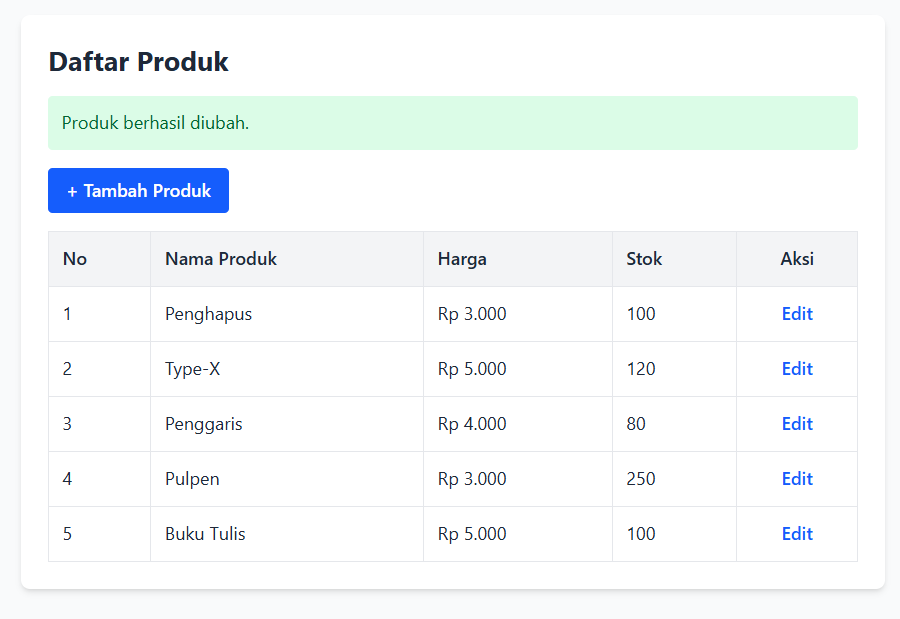
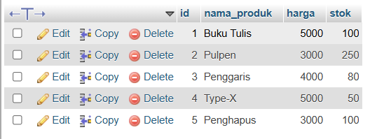

# Tugas 7 Praktikum PBW

## 1. Struktur Folder

```
penjualan-mvc/
├── controllers/
│   └── ProdukController.php
├── models/
│   └── ProdukModel.php
├── views/
│   └── produk/
│       ├── create.php
│       ├── edit.php
│       └── index.php
├── index.php
└── koneksi.php
```

| File | Peran | Fungsi |
|------|-------|--------|
| `models/ProdukModel.php` | Model | Mengelola data produk dan berinteraksi dengan database (SELECT, INSERT, UPDATE) |
| `views/produk/index.php` | View | Menampilkan daftar produk |
| `views/produk/create.php` | View | Form tambah produk |
| `views/produk/edit.php` | View | Form ubah produk |
| `controllers/ProdukController.php` | Controller | Menerima permintaan, memvalidasi input, memanggil Model, lalu memilih View |
| `index.php` | Pintu masuk | Membaca parameter `aksi` pada URL dan memanggil method Controller yang sesuai |
| `koneksi.php` | Koneksi | Menghubungkan PHP ke MySQL, sekaligus membuat database `penjualan` dan tabel `produk` secara otomatis |

## 2. Alur Kerja MVC

```
Browser → index.php?aksi=... → Controller → Model → Database
                                   ↓
                                 View → Browser
```

| URL | Method Controller | Hasil |
|-----|-------------------|-------|
| `index.php` | `index()` | Daftar produk |
| `index.php?aksi=create` | `create()` | Form tambah |
| `index.php?aksi=store` (POST) | `store()` | Simpan produk baru ke database |
| `index.php?aksi=edit&id=1` | `edit()` | Form edit terisi data lama |
| `index.php?aksi=update` (POST) | `update()` | Simpan perubahan ke database |

## 3. Database

Database: `penjualan`, tabel: `produk`

| Kolom | Tipe | Keterangan |
|-------|------|------------|
| id | INT, AUTO_INCREMENT | Primary key |
| nama_produk | VARCHAR(100) | Nama produk |
| harga | INT | Harga (Rp) |
| stok | INT | Jumlah stok |

Database dan tabel **dibuat otomatis oleh PHP** di `koneksi.php` saat halaman pertama kali dibuka, jadi tidak perlu import SQL manual:

```php
mysqli_query($koneksi, "CREATE DATABASE IF NOT EXISTS $nama_db");
mysqli_select_db($koneksi, $nama_db);

mysqli_query($koneksi, "CREATE TABLE IF NOT EXISTS produk (
    id INT AUTO_INCREMENT PRIMARY KEY,
    nama_produk VARCHAR(100) NOT NULL,
    harga INT NOT NULL,
    stok INT NOT NULL
)");
```
`IF NOT EXISTS` membuat perintah ini aman dijalankan berulang kali: jika database/tabel sudah ada, tidak terjadi apa-apa dan data tidak hilang.

## 4. Penjelasan Kode Penting

**Model – query dengan prepared statement**
```php
$stmt = mysqli_prepare($this->koneksi, "INSERT INTO produk (nama_produk, harga, stok) VALUES (?, ?, ?)");
mysqli_stmt_bind_param($stmt, "sii", $nama, $harga, $stok);
return mysqli_stmt_execute($stmt);
```
Semua akses database berada di Model, dan memakai prepared statement agar aman dari SQL Injection.

**Controller – menghubungkan Model dan View**
```php
public function index()
{
    $produk = $this->model->getAll();
    include __DIR__ . '/../views/produk/index.php';
}
```
Controller meminta data ke Model, lalu menyerahkannya ke View. View hanya bertugas menampilkan.

**index.php – routing**
```php
$aksi = $_GET['aksi'] ?? 'index';
switch ($aksi) { case 'create': $controller->create(); break; ... }
```

## 5. Screenshot Hasil

| Halaman | Gambar |
|---------|--------|
| Daftar produk |  |
| Form tambah produk |  |
| Form edit produk |  |
| Daftar setelah data ditambah/diubah |   |
| Data di database (phpMyAdmin) |  |

> Simpan semua gambar di folder `screenshots/` dengan nama sesuai tabel di atas.

## 6. Cara Menjalankan
1. Jalankan Apache & MySQL (XAMPP/Laragon).
2. Letakkan folder `penjualan-mvc` di `htdocs`.
3. Buka `http://localhost/penjualan-mvc/index.php` (database dan tabel terbuat otomatis).