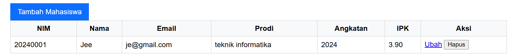
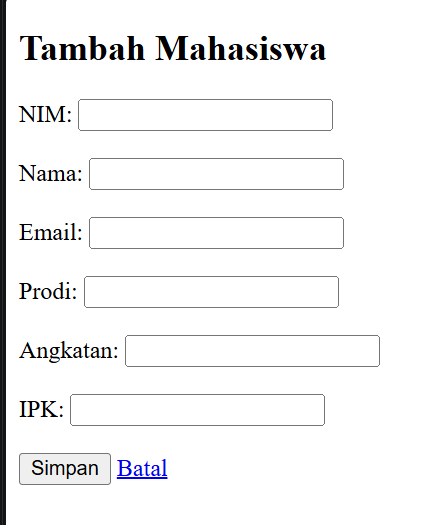
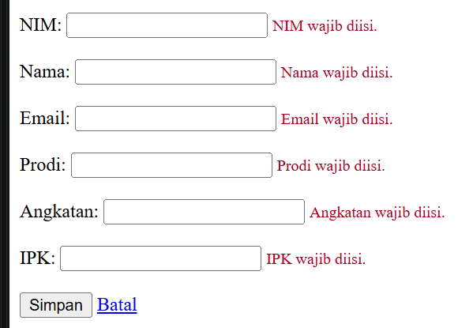
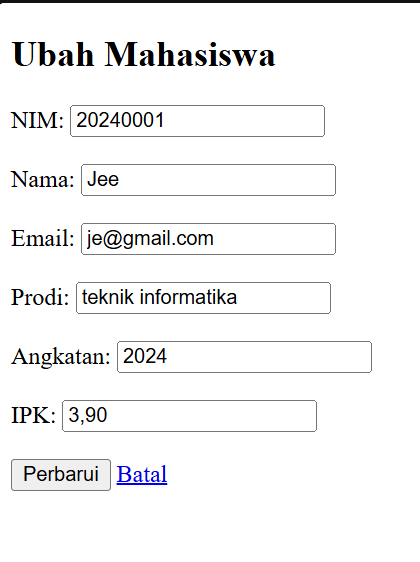
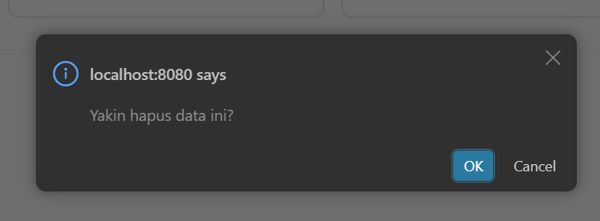
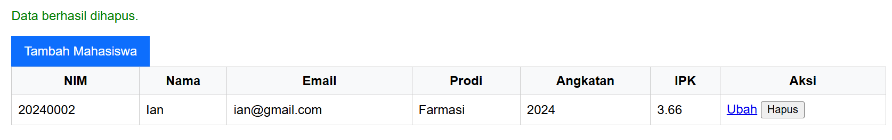

# Tugas 8 - CodeIgniter 4

Modul CRUD data mahasiswa sederhana menggunakan CodeIgniter 4, lengkap dengan
validasi input memakai *validation rules* CI4. Pesan kesalahan ditampilkan di view.

## Fitur
- Daftar data mahasiswa
- Tambah, ubah, dan hapus data
- Validasi input (NIM, nama, email, prodi, angkatan, IPK) dengan pesan error di form
- Pesan sukses setelah tambah, ubah, atau hapus data

## Aturan Validasi
| Field    | Aturan                                                  |
|----------|---------------------------------------------------------|
| NIM      | wajib, angka, 8-20 digit, unik                          |
| Nama     | wajib, 3-100 karakter                                   |
| Email    | wajib, format email valid                               |
| Prodi    | wajib                                                   |
| Angkatan | wajib, angka, tepat 4 digit                             |
| IPK      | wajib, angka antara 0 dan 4                             |

## Struktur Utama
- `app/Controllers/MahasiswaController.php` : logika CRUD dan validasi
- `app/Models/MahasiswaModel.php` : model tabel `mahasiswa`
- `app/Views/mahasiswa/` : `index.php`, `create.php`, `edit.php`
- `app/Config/Routes.php` : daftar route

## Cara Menjalankan
1. `composer install`
2. Buat database `db_kampus` di phpMyAdmin, lalu buat tabel `mahasiswa`
   (kolom: `id`, `nim`, `nama`, `email`, `prodi`, `angkatan`, `ipk`)
3. Salin `env` menjadi `.env`, lalu sesuaikan pengaturan `database.default.*`
4. `php spark serve`
5. Buka http://localhost:8080/mahasiswa

## Screenshot
### Daftar Mahasiswa

### Tambah Data

### Pesan Validasi

### Ubah Data

### Hapus Data

