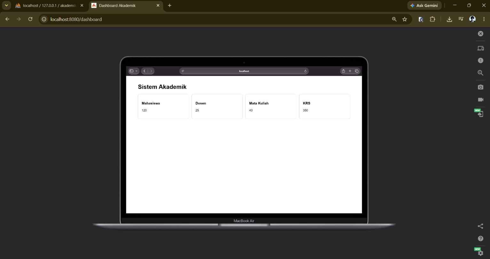
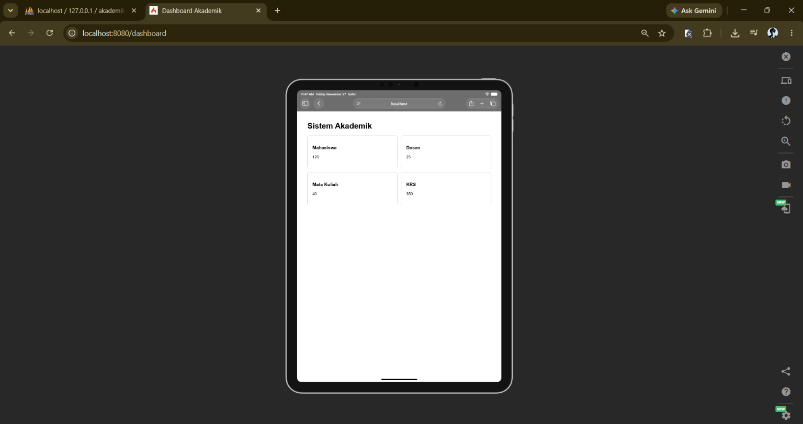
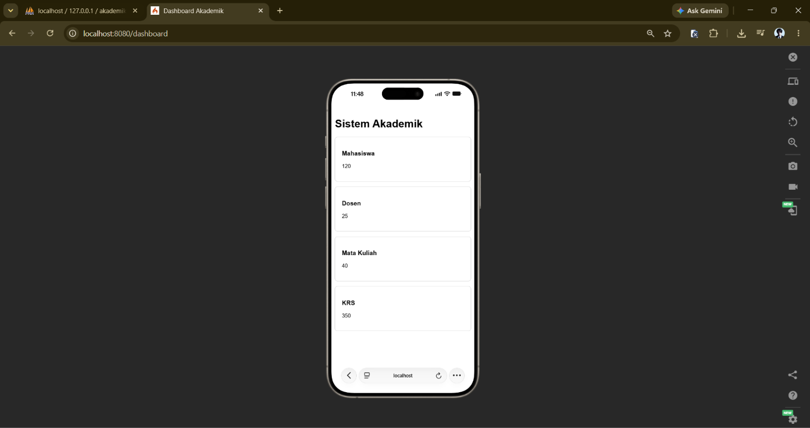

# Praktikum Pemrograman Berbasis Web - Tugas Kelompok Pertemuan 9

## 1. Identitas Kelompok

  1.     Raudha Hafsha Aqila        4524210123
  2.     Davina Arthamevia Azahra   4524210127
  3.     Refani Usman               4524210144

## 2. Tujuan Praktik

Praktik ini bertujuan untuk menguji tampilan halaman **Dashboard Sistem
Akademik** pada beberapa ukuran perangkat, yaitu desktop, tablet, dan
smartphone. Pengujian dilakukan untuk melihat bagaimana susunan komponen
dashboard menyesuaikan ukuran layar agar informasi tetap terlihat dan
mudah dibaca.

## 3. Studi Kasus

Studi kasus yang digunakan adalah halaman Dashboard Sistem Akademik yang
menampilkan empat informasi utama, yaitu:

-   **Mahasiswa:** 120
-   **Dosen:** 25
-   **Mata Kuliah:** 40
-   **KRS:** 350

Halaman dashboard menampilkan informasi tersebut dalam bentuk kartu
(card). Perbedaan ukuran layar memengaruhi susunan kartu yang
ditampilkan.

## 4. Hasil Visualisasi

### A. Tampilan Desktop

**Penjelasan:**

Pada tampilan desktop, halaman dashboard ditampilkan dalam ukuran layar
yang lebar. Keempat kartu informasi tersusun secara horizontal dalam
satu baris. Dengan susunan ini, informasi Mahasiswa, Dosen, Mata Kuliah,
dan KRS dapat dilihat berdampingan sehingga ruang layar digunakan secara
lebih luas.

### B. Tampilan Tablet

**Penjelasan:**

Pada tampilan tablet, ukuran area halaman lebih kecil dibandingkan
desktop. Kartu informasi menyesuaikan ruang yang tersedia dan tersusun
menjadi dua kolom serta dua baris. Susunan ini membuat setiap kartu
tetap memiliki ruang yang cukup dan informasi masih mudah dibaca.

### C. Tampilan Smartphone

**Penjelasan:**

Pada tampilan smartphone, lebar layar lebih terbatas sehingga keempat
kartu ditampilkan secara vertikal dalam satu kolom. Setiap kartu
menempati lebar area konten agar informasi tidak terlalu berdesakan dan
tetap nyaman dibaca melalui layar ponsel.

## 5. Perbandingan Tampilan

- Desktop                 4 kolom dalam 1 baris   Memanfaatkan layar
                                                  lebar

- Tablet                  2 kolom dalam 2 baris   Menyesuaikan lebar
                                                  layar menengah

- Smartphone              1 kolom dalam 4 baris   Kartu ditampilkan
                                                  secara vertikal

## 6. Kesimpulan

Berdasarkan hasil visualisasi, halaman Dashboard Sistem Akademik dapat
ditampilkan dalam tiga ukuran perangkat dengan susunan kartu yang
berbeda. Pada desktop, kartu tersusun dalam empat kolom; pada tablet,
kartu tersusun dalam dua kolom; sedangkan pada smartphone, kartu
tersusun dalam satu kolom. Perubahan susunan tersebut membantu dashboard
menyesuaikan ukuran layar perangkat sehingga informasi tetap terlihat
dan mudah dibaca.

## 7. Dokumentasi

Screenshot hasil pengujian untuk masing-masing perangkat disertakan pada
bagian Hasil Visualisasi di atas. Seluruh gambar disimpan bersama file
`README.md` agar dokumentasi dapat dibuka dengan benar.